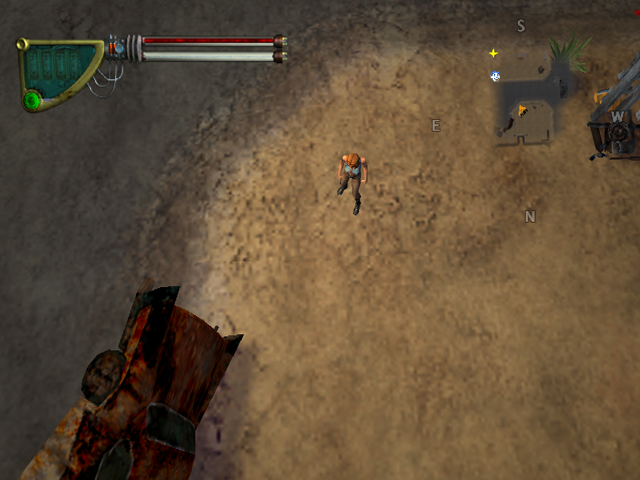
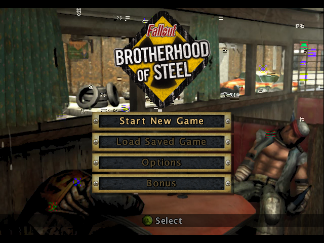
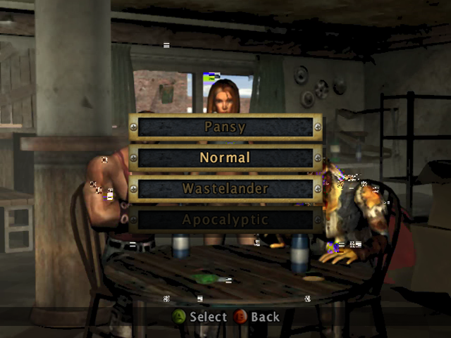

# falloutbos-recomp

Static recompilation of **Fallout: Brotherhood of Steel (Xbox, 2004)** to a
native Windows executable, using [xboxrecomp](https://github.com/sp00nznet/xboxrecomp).

No emulation. The x86 in `default.xbe` is translated to C, compiled, and linked
against the xboxrecomp runtime (kernel replacement, NV2A pushbuffer executor,
MCPX APU, USB). The game shipped on Xbox and PS2 only; there was never a PC
version.

This repo follows the xboxrecomp house style (layout, `regen.sh`, netlab
recipe) shared with [hl2-recomp](https://github.com/sp00nznet/hl2-recomp) and
the other titles. **It contains no game code or data.** The generated C is
derived from your own disc and is never distributed; you produce it locally.

## Status

**v0.1.0-dev, alpha.** It boots with no arguments and nothing forced, and the
modelled Xbox controller drives it: through the main menu, character and
difficulty select, chapter 1's intro, and into the first level, Carbon, with
Nadia on screen, the HUD up and the world textured. 0 faults and 0 unresolved
indirect calls in a 270 s scripted run.

Not yet good: the software rasteriser runs the level at about 15 fps (5 before
xboxrecomp [#228](https://github.com/sp00nznet/xboxrecomp/pull/228)), the Bink
videos show scattered block artifacts, and no one has played past the opening
dialogue yet.



 

*`fbos.exe` with `RECOMP_PB_EXEC=1`, captured from the surface the title's own
pushbuffer drew into. The level shot was reached headless with a scripted pad.*

| Step | State |
|---|---|
| XBE parsed | done: entry `0x0009547C`, 28 sections, 122 kernel imports, XDK 5558 |
| Disassembled | done: 3,881 functions (no RTTI in this image) |
| Codegen | done: 3,888 functions, 543k lines of C, 1 unresolved target (`sgdt`, never reached) |
| Kernel bridge | done: 122/122 imports resolved |
| D3D device + display mode | done: 640x480 X8R8G8B8 |
| DirectSound / APU | done: the title starts the APU itself, streams create |
| Async file streaming | done: needs deferred I/O APCs (see [docs/boot.md](docs/boot.md)) |
| Bink FMV | plays: Interplay logo, intro; block artifacts in motion |
| Main menu | done |
| Controller | done: the title's own USB stack enumerates the modelled pad |
| Menus to gameplay | done: character select, difficulty, chapter intro, Carbon |
| Gameplay | renders at ~5 fps; not played past the opening |

What it took, and why, is in [docs/boot.md](docs/boot.md).

### Conformance

| Check | Result | Command |
|---|---|---|
| Boot milestones, Interplay logo to Carbon, scripted pad | **8/8** | `py -3 tools/boot_check.py` |
| The title's own functions, native vs lifted (xboxrecomp `--xbe`, with #229) | 269 vectors, **3 mismatches** (x87 exception flags; one scratch overrun) | `(cd deps/xboxrecomp && py -3 -m tools.conformance --only corpus --xbe ../../game/default.xbe --xbe-limit 400)` |

`boot_check` fails only on a regression against `config/boot_check_baseline.json`,
and prints SKIP on a machine without game data. It is the netlab QA step
(`netlab check falloutbos-recomp`).

## Getting Started

You need your own **Fallout: Brotherhood of Steel (USA)** disc image (`.iso`).
Nothing from the game is downloaded or included.

### Quick start

1. Download this repo (Code → Download ZIP, or clone it) and unpack it.
2. Double-click **`Setup.cmd`**. It checks for Python, Git, CMake and the
   Visual Studio C++ build tools, and **asks before installing** anything
   missing (with what, why and how big). It finds your disc image or asks for
   it, then unpacks it, generates the C, and builds. Expect 10-20 minutes the
   first time, most of it the build. If it stops, it says why in one sentence
   and keeps the details in `setup.log`; running it again resumes.
3. Double-click **`Play.cmd`**. An XInput controller (Xbox 360/One pad) is
   player 1; the keyboard works too: WASD left stick, IJKL right stick,
   Z/X/C/V = A/B/X/Y, Enter = Start, Backspace = Back, 1/3 = triggers.

### Step by step

These are the commands `Setup.cmd` runs.

Prerequisites: Windows 10/11 x64; Python 3.10+ with `capstone`
(`py -3 -m pip install capstone`); Git for Windows (it provides `bash`);
CMake 3.20+; Visual Studio 2022 or its Build Tools with the C++ workload.
Use `py -3`, not `python`: the Microsoft Store alias for `python` is not a real
install. After installing anything, open a new terminal so PATH picks it up.

1. Get this repo and the toolkit. The port needs toolkit changes still in
   review (see [Toolkit changes](#toolkit-changes)); `work/falloutbos` has them
   all:

   ```bash
   git clone https://github.com/sp00nznet/falloutbos-recomp falloutbos
   cd falloutbos
   git clone --branch work/falloutbos https://github.com/sp00nznet/xboxrecomp deps/xboxrecomp
   ```

2. Unpack your disc into `game/`:

   ```bash
   (cd deps/xboxrecomp && py -3 -m tools.xiso unpack "/path/to/Fallout - Brotherhood of Steel (USA).iso" -o ../../game)
   ```

   Expected: `extracted 491 files to ../../game`.

3. Generate the C (about 3 minutes, most of it the disassembler):

   ```bash
   RECOMP=deps/xboxrecomp ./regen.sh --disasm
   ```

   Expected, at the end:

   ```
   3888/3889 functions (0 failed), 543025 lines of C, 8 source files
   1 unresolved call targets stubbed (addresses called but not detected as functions)
   ```

4. Build:

   ```bash
   cmake -S . -B build-msvc -A x64 -DXBOXRECOMP_DIR=deps/xboxrecomp
   cmake --build build-msvc --config Release
   ```

   The executable lands in `bin/fbos.exe`.

5. Run from the repo root (it reads `game/default.xbe`), or use `Play.cmd`:

   ```bash
   RECOMP_PB_EXEC=1 RECOMP_FB_WINDOW=1 RECOMP_KEYBOARD=1 ./bin/fbos.exe
   ```

## Usage

| Variable | Effect |
|---|---|
| `RECOMP_PB_EXEC=1` | execute the title's NV2A pushbuffer, so it actually draws |
| `RECOMP_FB_WINDOW=1` | show the framebuffer in a window. Off by default: runs are headless |
| `RECOMP_FB_DUMP=prefix` | write frames as `prefix00000.bmp` ... |
| `RECOMP_FB_DUMP_FLIPS=<file>` | dump every flip while `<file>` exists |
| `RECOMP_WATCHDOG_SECS=N` | after N seconds, report where the guest is |
| `RECOMP_KERNEL_LOG_BUDGET=N` | log the first N kernel calls (default 200) |
| `RECOMP_KEYBOARD=1` | keyboard as player 1 (see Getting Started) |
| `RECOMP_PAD_SCRIPT="ms:button,..."` | scripted presses for headless runs, e.g. `25000:start,35000:a` |
| `RECOMP_USB_STATS=1` | controller transfer counts every few seconds |
| `FBOS_PROFILE=<start>,<secs>` | sample every thread for `<secs>` seconds starting at `<start>`, print the top functions per thread |

`RECOMP_AC97_READY` and `RECOMP_USB` are set by `main.c` itself: the title
cannot initialise DirectSound without the first, or see a controller without
the second.

From power-on to Carbon, headless:

```bash
S="25000:start,35000:a,50000:a,65000:a"
for t in $(seq 80000 5000 250000); do S="$S,$t:a"; done
RECOMP_PAD_SCRIPT="$S" RECOMP_PB_EXEC=1 RECOMP_FB_DUMP=shot ./bin/fbos.exe
```

Headless capture, no window, works over RDP:

```bash
RECOMP_PB_EXEC=1 RECOMP_FB_DUMP=shot ./bin/fbos.exe
```

## Building from source

`./regen.sh` re-runs func_id, ABI analysis and codegen from the existing
disassembly; `./regen.sh --disasm` starts from the XBE. `RECOMP=<path>` points
it at a toolkit checkout other than `../xboxrecomp`. Entry tracing for
bring-up: list addresses in `config/trace_functions.json` and run
`TRACE_FUNCS=config/trace_functions.json ./regen.sh`.

Day-to-day builds go through [recomp-netlab](https://github.com/sp00nznet/recomp-netlab):
`netlab build falloutbos-recomp` (recipe `projects/falloutbos-recomp.env`).
The farm never sends `game/` or the disc image.

### Toolkit changes

Found by this port, each on its own branch in xboxrecomp:

| Branch | What |
|---|---|
| `fix/conformance-xbe-unimpl` ([#229](https://github.com/sp00nznet/xboxrecomp/pull/229)) | the real-title conformance harness builds on this game and no longer overruns on wide strings |
| `fix/disasm-tables-in-code-sections` ([#227](https://github.com/sp00nznet/xboxrecomp/pull/227)) | function-pointer tables inside XDK code sections (D3D's render-state handlers) |
| `fix/io-apc-delivery` ([#226](https://github.com/sp00nznet/xboxrecomp/pull/226)) | file I/O APC: restore esp after delivery; opt-in delivery at the next alertable wait |
| `perf/raster-batch-rows` ([#228](https://github.com/sp00nznet/xboxrecomp/pull/228)) | rasterise a draw's triangles together on the worker pool: 5.5 → 15 fps in Carbon |
| community PR #186 | `pushfd`/`popfd`/`cpuid` lifted as the hardware does them. Until it lands, `recomp_manual.c` overrides the one function that needs it |

## License

MIT, see [LICENSE](LICENSE). That covers the code in this repo only.
Fallout: Brotherhood of Steel and its data belong to their owners; nothing from
the game is in this repo, and the generated C is never committed.
